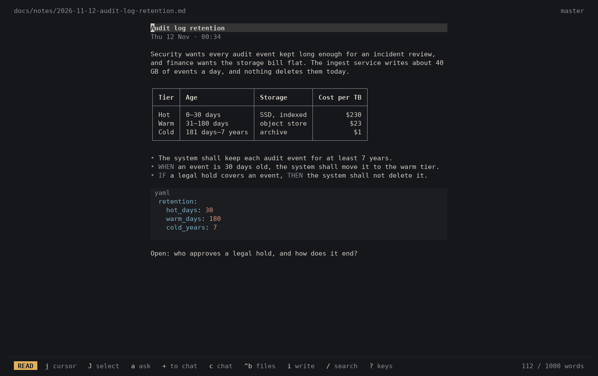

# zendo

A quiet room for architecture thinking, with the agents at work next door.



A zendo is the hall where Zen practitioners sit for zazen, seated meditation.
Architecture work feels much the same: you sit with a problem until it settles.


## Why zendo

Agents became the tool for most tasks, and they live in the terminal. But
spec-driven development is still reading and writing documents. Today you
switch to another window for that, or you ask the chat to show you a quote.

For people who write specifications more than code, the main tool is still the
text editor. Or it should be. Agents moved that work into a chat. zendo brings
the focus back to the specification: the document is the main pane, and the AI is the
assistant beside it, as it should be. You open, read and edit a file with a
key, in the same terminal window, and the chat stays open.

For some people, VS Code or another IDE does this job. zendo is mainly for
those who put the lightness, the speed and the clarity of a command line
first. It feels like an IDE, and in many ways it is one: a file tree, an
editor, terminals, agents. But an IDE is not the goal of zendo. The goal is
to write specifications and give them to agents.

Zendo implements SDD in three steps:

1. **Jot** a thought the moment it comes.
2. **Think** it through in the document, with an agent as a sharp reviewer.
3. **Build**: give the work to agents, and stay in the document while they work.

## Jot

Run `zendo`, press `n` and type. Skip the title: the agent adds one when you
leave write mode. Write mode saves by itself.

Notes are plain markdown. They live in one of two places:

- **In the project repo**, in `docs/notes`. No setup. The notes go through git
  and review with the code they describe.
- **In your private notes repo.** zendo shows only the notes of the project you
  are in, and commits and pushes in the background.

  ```sh
  zendo setup --notes-repo git@github.com:you/notes.git
  ```

Outside a repository, `zendo` opens a scratchpad.

## Think

The document is the main pane. The file tree, the chat and the delta open
beside it when you need them.

- **Where you left off.** A recap says what the file is about and what changed
  since the last commit. The delta (`d`) shows, word by word, what changed since
  you last worked on the file, also when the change came from an agent or git.
- **Ask about a selection.** Select text and press `a`. The agent gets the file,
  the selection and the rules of the project.
- **Say it differently.** Select text in the document and press `alt-s`, then
  `enter`. The agent writes the selection again, so that it agrees with the
  rest of the document: the same style, the same level of detail.
- **Review.** `ctrl-r` twice: the agent marks the lines that confuse a reader,
  and says why.
- **Documents that stay short.** Past the word limit (1,000 by default) the text
  turns red. `S` asks the agent to split the document and keep each part at one
  level of detail.

The agent edits the files at once; zendo does not ask you for each edit. You
check the result in the delta. Tell the agent how to review you in
`.zendo/prompt.md`: requirement style, tone, how blunt.

## Build

When the design holds, the agents build, and you do not leave zendo.

- **Five agent sessions.** `F6` to `F10` choose a session. Each session is one
  thread for the whole repository: one does research while you discuss in
  another.
- **Claude Code in the background.** `ctrl-o` opens Claude Code on the active
  session, with the whole discussion behind it. `alt-q` takes you back to the
  document, and Claude Code continues. The session buttons show its state:
  works, waits or idle.
- **Terminals.** A green `▶` marks a shell command in an answer. `F5` puts the
  command into a terminal, and you press `enter` to run it. `alt-F5` runs it at
  once. The agent never runs a command; only you do.

## Project structure

`project-structure.toml` in the root of the repository says what lives where.
zendo shows its main materials as the file tree, so the architecture documents
are a few keys away. Agents read the same file, so they know where a new
document goes.

```sh
zendo doctor          # makes the file from a template when there is none
zendo doctor --fix    # the agent repairs a file that zendo does not understand
```

**From notes to a specification.** `ctrl-t` in the chat adds a template. The
agent writes the new document from the notes you name with `@`.


## Agents

zendo talks to its agent over the Agent Client Protocol. It supports Claude,
the default, and Codex:

```sh
zendo setup                  # Claude: log in with `claude auth login`
zendo setup --agent codex    # Codex: log in with `codex login`
```

When an agent cannot do something, only that key is off. With Codex, that is
`ctrl-o` and the background sessions.

## Install

```sh
curl -fsSL https://raw.githubusercontent.com/mtuchkov/zendo/main/install.sh | sh
```

You need Node.js 22 LTS (18+ works), and Claude Code or Codex logged in.
`zendo doctor` checks each step of the setup. When a new version is out, the
top bar says so: press `U`. For proxies and certificates, see
[INSTALLATION.md](INSTALLATION.md).

### macOS

The same line installs zendo on macOS. The installer builds zendo on your Mac, and a zendo built on
macOS uses the macOS keys: Option is the zendo key, Ctrl stays for the text.

- **Option is Meta.** Terminal.app: Settings > Profiles > Keyboard > "Use Option as Meta key".
  iTerm2: Settings > Profiles > Keys > Left Option key: "Esc+". Ghostty: `macos-option-as-alt = true`.
  The installer names the setting for your terminal.
- **No F-keys.** `alt-1` to `alt-5` choose an agent session, `alt-0` opens the terminal, `alt-r` runs
  the shell block. The F-keys work too, with `fn`.
- **Text keys of a Mac.** Option-← and Option-→ move by a word, `ctrl-a` and `ctrl-e` go to the start
  and the end of a line. The file tree is `alt-e`.
- **Finder keys in the file tree.** `r` renames, `n` makes a file, `N` makes a folder, `backspace`
  deletes after a question.
- For `ctrl-shift` keys, use a terminal with the kitty keyboard protocol: Ghostty, kitty, WezTerm,
  or iTerm2 with "Report keys using CSI u".

All the macOS keys: [INSTALLATION.md](INSTALLATION.md#macos-keys) and
[resources/keymap-macos.toml](resources/keymap-macos.toml). `zendo keymap` prints every key.

## More

- [docs/zendo/zendo.md](docs/zendo/zendo.md): the specification (draft).
- [docs/architecture/decisions](docs/architecture/decisions): the decisions.
- [INSTALLATION.md](INSTALLATION.md): install, upgrade, keys, code highlighting,
  the notes repo, certificates, removal.
