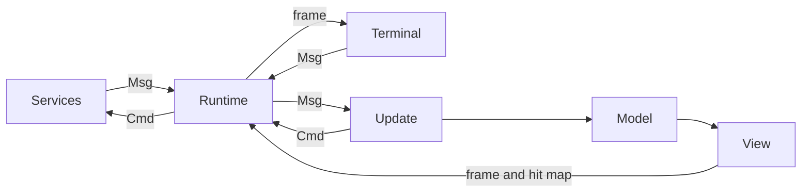

# The architecture of the zendo TUI

zendo follows The Elm Architecture (TEA). A synchronous core holds the state and decides what
happens. An asynchronous runtime around the core does all IO. The UI loop never waits for IO.

Children:

- [Components, keys and view](components.md): the components, the modes, the overlays, the
  keys, the view, and the mouse.
- [Asynchronous IO](async-io.md): the subscriptions, the executor, the UI loop, the
  responsiveness, and the writes of user data.

## Layers

| Layer | Holds | Does IO |
| ----- | ----- | ------- |
| Core | `Model`, `Msg`, `Cmd`, `Sub`, `init`, `update`, `layout`, `view`, `subscriptions`. | No. |
| Runtime | The terminal, the UI loop, the executor of commands, the subscriptions, the render. | Yes. |
| Services | The agent (ACP), the PTY sessions, git, find, the music, the board, the update check. | Yes. |

- The core shall not use tokio, the file system, a clock, or a process.
- A service shall talk to the core only through `Cmd` and `Msg`.

## Core

- `init(Config)` shall return `(Model, Vec<Cmd>)`. The first frame shall draw before the app
  reads a file.
- `update(&mut Model, Msg)` shall return `Vec<Cmd>` and shall do no IO.
- Each time value shall come in a `Msg`. The core shall not read a clock.
- Each side effect shall be a `Cmd`. The result of a command shall come back as a `Msg`.
- `layout(&Model)` shall be a pure function of the model and of the screen size from
  `Msg::Resize`. It shall give the rectangle of each pane.
- `update` shall correct scroll and cursors with `layout`. `view` shall not change them.
- `view(&Model, &Cache)` shall only read the model.

The model is mutable: `update` changes it in place. Pure here means no IO and no clock, not
immutable data.

## Messages and commands

`Msg` is every input to the core:

- terminal input: keys, mouse, paste, focus, resize;
- results of commands: a file read, a write that ended or failed, a git answer, a find result;
- service events: agent events, PTY output, the file watcher, the board;
- timers, with the time in the message.

`Cmd` is every effect that the core asks for: read or write a file, send to the agent, start or
stop a session, run git, search, copy to the clipboard, ring the bell, open a file outside, quit.

## Checks of the rules

- A test shall fail if a file of the core uses the file system, a clock, a process, or tokio.
- A unit test of a component shall give a model and a `Msg`, and shall check the new model and the
  list of `Cmd`, with no disk and no agent.
- A scenario test shall give a list of `Msg` and shall check the screen on `TestBackend`.
- A scenario test with fake services that answer after 5 s shall check that each key still changes
  the screen within the time budget.
