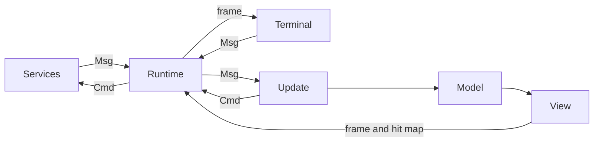

# Internals of the TUI

Sources: the [zendo book](../../book/zendo-book.md), the target architecture of the TUI (User,
2026-11-20). This document and its children take the place of
`docs/architecture/tui-architecture` (User, 2026-11-20).

Parent: [zendo](../zendo.md). The decision is in
[ADR 0028](../../architecture/decisions/0028-a-core-that-decides-and-a-runtime-that-does.md).

The other children of [zendo](../zendo.md) state what the user sees and does. These documents state
the rules that the code of the TUI keeps, so that three qualities hold: the screen never waits for
IO ([Responsiveness](../responsiveness.md)), a failure loses no data of the user
([Failure default](../failures.md)), and each part has tests that need no disk and no agent.

The book explains each idea. The specification with the name of the chapter states the idea as
requirements with acceptance tests. The book is the target: a difference between a chapter and its
specification is a defect of the specification. Where the book differs from an older specification
or decision record, the book takes priority (User, 2026-11-21).

## The parts

| Part | Holds | Does IO |
| ---- | ----- | ------- |
| Core | `Model`, `Msg`, `Cmd`, `Sub`, `update`, `layout`, `view`, `subscriptions`. | No. |
| Runtime | The terminal, the UI loop, the executor of commands, the sources of subscriptions, the frame writer. | Yes. |
| Services | The agent (ACP), the PTY sessions, git, find, the disk, the music, the board. | Yes. |

## The path of an event

An event becomes a `Msg`. `update` changes the model and returns `Cmd`. The runtime does the
commands asynchronously and returns the results as new `Msg`. `subscriptions` tells which streams
of events are necessary now. `layout` calculates the sizes. `view` only reads the model and builds
the frame. A click becomes a `Msg` through the hit map. The components are isolated and send
messages through their parent. The UI loop waits only for messages, so no IO can stop it.

## Documents

| Document | Chapter of the book | IDs |
| -------- | ------------------- | --- |
| [Core and runtime](core-and-runtime.md) | [Core and Runtime](../../book/01-decide-and-do.md) | CORE |
| [Messages](messages.md) | [Messages (Msg)](../../book/02-messages.md) | MSG |
| [Commands](commands.md) | [Commands (Cmd)](../../book/03-commands.md) | COMMAND |
| [The model](model.md) | [The model (Model)](../../book/04-model.md) | MODEL |
| [The view](view.md) | [The view](../../book/05-view.md) | VIEW |
| [Layout and the mouse](layout-and-mouse.md) | [Layout and the mouse](../../book/06-layout-and-mouse.md) | LAYOUT, MOUSE |
| [Components](components.md) | [Components](../../book/07-components.md) | COMP |
| [The active panel and overlays](active-panel-and-overlays.md) | [The active panel and overlays](../../book/08-active-panel-and-overlays.md) | ACTIVE, OVERLAY |
| [The keymap](keymap.md) | [The keymap](../../book/09-keymap.md) | KEYMAP |
| [Subscriptions](subscriptions.md) | [Subscriptions](../../book/10-subscriptions.md) | SUB |
| [Async IO](async-io.md) | [Async IO](../../book/11-async-io.md) | ASYNC |
| [Tickets and cancellations](tickets-and-cancellations.md) | [Tickets and cancellations](../../book/12-tickets-and-cancellations.md) | TICKET |
| [The frame and the time budget](frame-and-budget.md) | [The frame and the time budget](../../book/13-frame-and-budget.md) | FRAME, BUDGET |
| [File writes](file-writes/file-writes.md) | [File writes and external consistency](../../book/14-file-writes.md) | WRITE |
| [The document](document/document.md) | [The document](../../book/15-document.md) | DOC |

## Shared inputs of the acceptance tests

- **Values only**: a unit test of the core builds a model, gives it a message, and checks the
  model, the commands and the out-messages. It uses no folder, no agent and no wait.
- **Test time**: the test puts the time into the messages and gives `now` to `view`.
- **Test backend**: a screen test draws the view on `TestBackend` of ratatui and compares the lines.
- **Fake services**: a scenario test runs the runtime with services that the test controls. A fake
  service records each call, holds its answer until the test lets it go, or answers after a set
  time. The fake disk and the fake terminal are such services.
- **Source check**: a unit test that reads the source code of zendo, as
  `actions_hold_no_measurement_code` does for RESP-2.

## Open points

| Open question | Affects | Answered by |
| ------------- | ------- | ----------- |
| No milestone document plans the move of the code of zendo 0.126 to this architecture. Which steps does the move have, and which temporary behavior? | All children | User |
